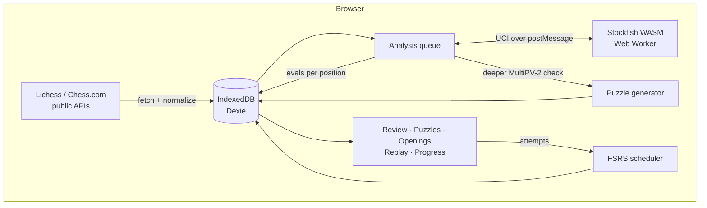

# chess.ai

**Train on your own mistakes.** A free chess improvement trainer that imports your Lichess or Chess.com games, analyzes every move with Stockfish **in your browser**, and turns what went wrong into practice: puzzles from your blunders, drills for your opening habits, replays of the positions where games turned, all scheduled with spaced repetition.

It costs nothing to run: no server-side data, no accounts, no paid APIs, no language model. Everything is stored in your browser.

## Features

| | |
|---|---|
| **Game review** | Step through any game with an eval bar, an eval graph, Stockfish's best line, and `?!` / `?` / `??` on inaccuracies, mistakes and blunders |
| **Explanations** | One-sentence notes built from what the engine's lines show when replayed: *"This hangs the bishop on e6 to Bxe6."* |
| **Accuracy** | Per-player accuracy with Lichess's formula |
| **Puzzles** | Positions before your mistakes, kept only when one move is clearly best; up to three moves long, tagged by theme |
| **Spaced repetition** | FSRS schedules every puzzle and drill; attempts are graded automatically from how they went |
| **Opening trainer** | A tree of your openings, the positions where you habitually lose ground ranked by cost, and drills for the fix |
| **Replay mode** | Replay a lost game from its turning point (or any move) against Stockfish at six strengths |
| **Progress** | Weekly accuracy, blunder rate and puzzle results, plus where errors cluster by phase, clock and opening |
| **Your data** | JSON backup export and restore; nothing leaves the browser |

## How it works



1. **Import.** The browser calls the Lichess and Chess.com APIs directly (both allow cross-origin requests). Adapters normalize both sites into one `Game` shape with SAN moves, a clock per move and the result from your side. Later syncs fetch only newer games.
2. **Analyze.** Stockfish 19 (lite, single-threaded WebAssembly) runs in a Web Worker at depth 14. Evals are cached **per position**, not per game, so an opening shared by many games is analyzed once, and interrupted games resume.
3. **Judge.** Inaccuracy, mistake and blunder use **Lichess's own rules**, ported from its source: 5/10/15-point drops in win chance, plus special handling for forced mates. A test feeds Lichess's evals for real games into the port and requires Lichess's exact verdict on every move, and accuracy within one point.
4. **Explain.** Explanations come from templates. The engine's lines are replayed with chess.js, and material is counted once captures stop, so a trade isn't mistaken for a lost piece.
5. **Practice.** Each mistake gets a depth-18, two-line search. It becomes a puzzle only if the best move beats the second by 15+ points of win chance. Opening weak spots come from your own move tree. Both feed one FSRS scheduler, with a daily queue and a full review log.

## Tech stack

Next.js 16 (App Router) · React 19 · TypeScript · Tailwind CSS 4 · shadcn/ui on Base UI · chess.js · react-chessboard · Stockfish.js · Dexie (IndexedDB) · ts-fsrs · Recharts · Zod · Vitest. Deployed on Vercel.

## Development

```bash
npm install     # also copies the Stockfish engine into public/stockfish/
npm run dev     # http://localhost:3000
npm test
npm run lint
npm run build
```

No environment variables are needed. On Vercel, import the repository and keep the defaults.

## Project layout

```
app/            routes: /, /u/[platform]/[username], /review/..., /play/...,
                /puzzles, /openings, /progress, /about
components/     board, games, review, puzzles, openings, replay, progress, ui
lib/sources/    Lichess and Chess.com adapters, sync
lib/engine/     Stockfish wrapper, analysis queue, opponent
lib/analysis/   win %, move judgements, accuracy (Lichess ports)
lib/explain/    engine-fact extraction and explanation templates
lib/puzzles/    puzzle generation, themes, solving rules
lib/openings/   opening tree, weak spots, drill rules
lib/srs/        FSRS scheduling, grading, daily queue
lib/stats/      progress statistics
lib/db/         Dexie schema and backups
tests/          Vitest suites, including real-game fixtures
```

## Credits and licenses

- [Stockfish](https://github.com/official-stockfish/Stockfish) (GPL-3.0), via the [stockfish.js](https://github.com/nmrugg/stockfish.js) WebAssembly build (GPL-3.0). `npm install` copies the unmodified engine and its license into `public/stockfish/` (see `scripts/copy-stockfish.mjs`), so the binary isn't committed.
- Win-chance, accuracy and move-judgement formulas follow [Lichess](https://github.com/lichess-org/lila) (AGPL-3.0).
- [chess.js](https://github.com/jhlywa/chess.js) (BSD-2-Clause), [react-chessboard](https://github.com/Clariity/react-chessboard) (MIT), [ts-fsrs](https://github.com/open-spaced-repetition/ts-fsrs) (MIT), [Dexie](https://github.com/dexie/Dexie.js) (Apache-2.0), [Recharts](https://github.com/recharts/recharts) (MIT), [Lucide](https://github.com/lucide-icons/lucide) (ISC).
